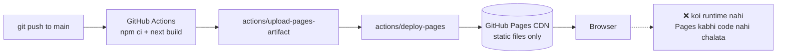
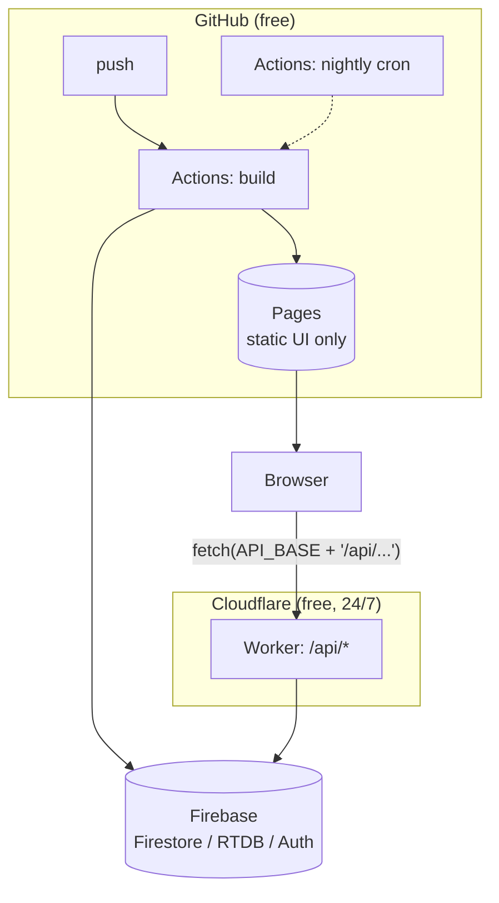

# Vercel ká kaam → GitHub Actions + Pages: kya-kya ho sakta hai

**Date:** 2026-11-15 · **Repo:** `Mizanora-org/MIZANORA` @ `69ec816`
**Sawal:** "Vercel jo kaam karta hai wo hum workflow ke zariye 24/7 kar sakte hain? GitHub Pages se connect hoke kaise rahega?"

---

## 1. TL;DR — teen kaam, sirf do ho sakte hain

Vercel ek platform hai jo **teen bilkul alag** kaam karta hai. Workflow unme se sirf **do** replace kar sakta hai:

| # | Vercel ka kaam | GitHub Actions se? | Kyun |
|---|----------------|--------------------|------|
| 1 | **Build + deploy** (git push par) | ✅ **Haan, 100%** | Ye batch kaam hai — Actions ka asli maqsad |
| 2 | **Cron jobs** (`/api/cron/security` daily) | ✅ **Haan** (chhoti shartein) | Actions me `schedule:` hai |
| 3 | **Runtime — request handle karna** (89 API routes, middleware, ISR, orders, admin, media relay) | ❌ **Kabhi nahi** | Actions ek **batch job runner** hai, **web server nahi** |

> **Sabse zaroori line:** Workflow 24/7 "chalta" reh sakta hai, magar wo visitor ki request ka jawab **nahi de sakta**. Ye do alag cheezein hain. Isi liye "GitHub Pages + workflow" se Vercel ka **poora** replacement nahi banta.

---

## 2. Kaam 1 — Build + Deploy: poora ho jayega ✅

Ye Vercel ki "CI/CD" thi. GitHub Actions ise **behtar** karta hai, kyunki public repo par **Actions minutes unlimited** hain (Vercel ke build minutes se bhi zyada).

Pages se **connection** ka tareeqa yahi hai — ek **one-way pipeline**:



Repo setting: **Settings → Pages → Build and deployment → Source = "GitHub Actions"**
Uske baad har push par site khud update hoti hai. Bas. **Koi persistent "connection" nahi hota** — Pages sirf files leta hai, aur kuch nahi.

**Ready-to-use YAML** (`.github/workflows/pages.yml`):

```yaml
name: Deploy to GitHub Pages
on:
  push: { branches: [main] }
  workflow_dispatch:
  schedule:
    - cron: "17 2 * * *"        # roz 02:17 UTC — "poor man's ISR"

permissions:
  contents: read
  pages: write
  id-token: write

concurrency:
  group: pages
  cancel-in-progress: false

jobs:
  build:
    runs-on: ubuntu-latest
    steps:
      - uses: actions/checkout@v4
      - uses: actions/setup-node@v4
        with: { node-version: 22, cache: npm }
      - run: npm ci
      - run: npm run build
        env:
          NEXT_PUBLIC_SITE_URL: https://mizanora-org.github.io/MIZANORA
          NEXT_PUBLIC_FIREBASE_API_KEY: ${{ secrets.NEXT_PUBLIC_FIREBASE_API_KEY }}
          NEXT_PUBLIC_FIREBASE_PROJECT_ID: ${{ secrets.NEXT_PUBLIC_FIREBASE_PROJECT_ID }}
          FIREBASE_SERVICE_ACCOUNT: ${{ secrets.FIREBASE_SERVICE_ACCOUNT }}
      - uses: actions/configure-pages@v5
      - uses: actions/upload-pages-artifact@v3
        with: { path: out }       # output:'export' ka folder
  deploy:
    needs: build
    runs-on: ubuntu-latest
    environment:
      name: github-pages
      url: ${{ steps.deployment.outputs.page_url }}
    steps:
      - id: deployment
        uses: actions/deploy-pages@v4
```

⚠️ **Sach:** ye YAML aaj likhne se **site live nahi hogi** — pichli report me build `output: 'export'` par **fail** hota hai (`/blog/feed.xml`, phir `/manifest.webmanifest`). Pehle wo 8 blockers theek karne honge (Section 7).

---

## 3. Kaam 2 — Cron: ho jayega, magar shartein ✅⚠️

Vercel ka `crons` (`/api/cron/security`, daily) Actions `schedule:` se replace ho jata hai. Magar GitHub ke cron me **4 ahem limits** hain:

| Limit | Value | Mizanora par asar |
|-------|-------|-------------------|
| Minimum interval | **5 minute** | Rozana job ke liye koi masla nahi |
| Timing guarantee | **Koi nahi** — 10 se 60 min tak late, load par skip bhi | Security sweep ko exact 2:00 AM chahiye to na kaam karega |
| Timezone | **UTC only** | Pakistan = UTC+5, hisaab lagana padega |
| **60 din inactivity = auto-disable** | Public repo me, sirf **commit** timer reset karta hai | **Sabse bada khatra** — workflow chup-chaap band ho jayega, koi error nahi |

**60-din wale trap ka hal:** aapki nightly workflow khud ek chhota data commit kare (ya `keepalive` step), to timer reset hota rehta hai. Ye zaroori hai — warna 2 mahine baad sab kuch chup-chaap ruk jayega.

---

## 4. Kaam 3 — Runtime: **bilkul nahi** ❌ (ye asli masla hai)

Ye woh hissa hai jo log sabse zyada miss karte hain. **Actions ek server nahi hai.**

Actions tabhi chalta hai jab koi **trigger** ho — push, cron, ya webhook. Aap isse keh nahi sakte: *"ruko, ab ek visitor aaya hai, iski request handle karo."* Aisa mechanism maujood hi nahi.

Iska matlab aapke **89 API routes** (aur `middleware.js`) ke saath ye hota hai:

| Feature | Vercel | GitHub Pages + Actions |
|---------|--------|------------------------|
| Cart / checkout / order place karna | ✅ `/api/orders` | ❌ **mar jayega** |
| Wishlist, account sessions, track order | ✅ | ❌ |
| Admin panel (**32 routes**) — products, ads, tv, security | ✅ | ❌ **poora admin dead** |
| Worker apply / payouts | ✅ | ❌ |
| Live TV relay, poster relay, song stream | ✅ | ❌ |
| AI assistant / TTS / search | ✅ | ❌ |
| IP blocklist (middleware) | ✅ | ❌ |
| ISR — naya product khud aa jana | ✅ | ❌ (agle rebuild ka intezaar) |
| Static pages serve karna | ✅ | ✅ |

**33 client files** `fetch('/api/...')` karti hain (56 call sites). Pages par ye sab `https://mizanora-org.github.io/api/...` hit karengi → **404** → cart, checkout, account, assistant — sab khaali screen.

---

## 5. "24/7" ka asli matlab — kis cheez ke liye

| Cheez | 24/7 kaise? |
|-------|-------------|
| Static files serve karna | ✅ Pages khud 24/7 karta hai (CDN) |
| Naya content publish karna | ⚠️ **Sirf jab workflow chale** — roz 1 dafa |
| Cron/security sweep | ⚠️ Roz 1 dafa, 10-60 min late ho sakta hai |
| **User ki request ka jawab dena** | ❌ **Kabhi nahi** — iske liye asli runtime chahiye |

Yani: website **24/7 khuli** rahegi, magar uski **aadhi functionality 24/7 nahi**, kyunki wo functionality maujood hi nahi hogi.

---

## 6. To runtime kahan jayega? (asli 24/7 options)

Agar aap GitHub Pages par hi rehna chahte hain, to API ke liye **alag always-on compute** lazmi hai:

| Platform | Free tier | Card chahiye? | Next.js 15 / Node | Verdict |
|----------|-----------|---------------|-------------------|---------|
| **Cloudflare Workers** | 100k req/**din** | **Nahi** | OpenNext ke saath ✅ | **Sabse behtar free 24/7** |
| **Cloudflare Pages** (OpenNext) | Unlimited static + 100k fn/din | Nahi | ✅ | Poora app ek jagah |
| Netlify Functions | 125k req/mahina | Nahi | ✅ | Thik |
| Firebase Functions | 2M req/mahina | **Haan (Blaze)** | ✅ | Aap Firebase par ho, magar card |
| Render free | Spins down 15 min baad | Nahi | ✅ | Cold start 30-60s — "24/7" nahi |
| Railway / Fly.io | Paid | Haan | ✅ | — |

**Ahem:** `firebase-admin` **Cloudflare Workers par nahi chalta**. Aapko `lib/firestore-rest.js` (jo repo me pehle se maujood hai) ya RTDB REST par jaana padega. Ye chhota kaam nahi.

**Sabse behtar architecture agar Pages lazmi hai:**



Isme **56 fetch calls** ko `NEXT_PUBLIC_API_BASE` par bhejna padega, aur 89 routes ko Worker par port karna padega. **Effort: 2-4 hafte.**

---

## 7. Jo aaj bhi possible hai (aapki asli problem ka hal)

Aapki problem Vercel ka pause/quota hai — **Pages uska hal nahi**. Behtar: **poora app ek free Node platform par**, GitHub Actions se 24/7 deploy.

```
GitHub Actions (build) → Cloudflare Workers + OpenNext → 100% features, 24/7, free, no card
```

Isme **code change ~0**, sirf config. **1-2 din.** Aur Vercel ka **cron bhi** Actions se chal jayega.

**Pages sirf tab rakhein jab:** marketing/status fallback page chahiye (Option C, pichli report).

---

## 8. Hard limits — yaad rakhne wali

| Limit | Value |
|-------|-------|
| Pages published site size | **1 GB** |
| Pages bandwidth | 100 GB/mahina (soft) |
| Pages builds/hour | 10 (branch se) — **unlimited** Actions se |
| Pages: serverless functions | **Zero** |
| Pages: runtime env vars | **Nahi** |
| Actions job max | **6 ghante** |
| Actions minutes | Public repo **unlimited**; private 2,000/mahina |
| Actions cron minimum | 5 minute |
| Actions cron auto-disable | **60 din inactivity** (public repo) |

### 1 GB limit ka ahem hisaab

Pichli report: 11,297 products, 500,000 IMDb titles.

| Kya pregenerate karein | Size (approx) | 1 GB me? |
|------------------------|---------------|----------|
| 11,297 product pages (~20 KB HTML each) | **~230 MB** | ✅ Fit ho jayega |
| 500,000 movie pages | **~10 GB** | ❌ **Kbilkul na mumkin** |
| Song + `/api/*` static files | ~50 MB | ✅ |

**Natija:** products ko static kiya ja sakta hai (nightly rebuild), **movies ko har haal me runtime chahiye**. Yani full static = movies ka poora section khatam.

---

## 9. Seedha jawab

| Sawal | Jawab |
|-------|-------|
| Build + deploy 24/7 workflow se? | **Haan** — Vercel se behtar |
| Cron 24/7 workflow se? | **Haan**, magar 60-din trap ka dhyan rahe |
| **API / cart / admin / orders 24/7 workflow se?** | **Nahi. Kabhi nahi.** Workflow request handle nahi karta |
| Pages se "connect" kaise rahega? | Ek **one-way pipeline**: Actions build karta hai → artifact → `deploy-pages` → Pages serve karta hai. Runtime connection **maujood nahi** |
| Poora Vercel replace hoga? | **Pages se nahi.** Cloudflare Workers/Pages se **haan** |

**Mera mashwara:** GitHub Pages par zid chhorein. Repo me GitHub Actions workflow add karein (jo har haal me faida dega — Vercel par bhi kaam aata hai), aur hosting **Cloudflare Workers + OpenNext** ya **Firebase App Hosting** par le jayein. Poora app 100% chalega, 24/7, free.

Bolein to main:
1. **Cloudflare Workers** ka complete setup bana doon (config + workflow + env), **ya**
2. **Firebase App Hosting** ka (`apphosting.yaml` + workflow), **ya**
3. Pages wala hybrid plan (2-4 hafte) — jaanna hai to detail bana doon.
